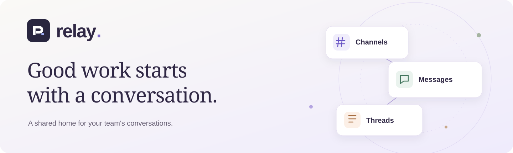

<p align="center">
  
</p>

<h1 align="center">Relay</h1>

<p align="center">
  <strong>A shared home for your team's conversations.</strong><br>
  Project channels, direct messages, threads, and files — together in one workspace.
</p>

<p align="center">
  <a href="https://github.com/husnain381a/Relay/actions/workflows/ci.yml"></a>
  <a href="LICENSE"></a>
</p>

<p align="center">
  <a href="#features">Features</a> ·
  <a href="#quick-start">Quick start</a> ·
  <a href="#install-relay">Install the app</a> ·
  <a href="#deployment">Deployment</a> ·
  <a href="CONTRIBUTING.md">Contribute</a>
</p>

---

Relay is an open-source team messaging app for keeping conversations connected to the work around them. Give each project a channel, take a detailed discussion into a thread, or reach a teammate directly. Search past conversations, save useful messages, and share files from the same place.

Use Relay in a browser or install it as a web app on your desktop or phone. Run your own instance with your own backend, and adapt the source to your team's needs.

## Features

| Feature                   | What you can do                                                                                                     |
| ------------------------- | ------------------------------------------------------------------------------------------------------------------- |
| **Workspaces & channels** | Create separate team spaces with public and private channels, topics, member management, and invitations.           |
| **Direct conversations**  | Talk one-to-one or bring a small group together in a direct message.                                                |
| **Messages with context** | Write rich text or Markdown, mention teammates, react, edit messages, and keep follow-ups in threads.               |
| **Find & organize**       | Search messages and files, pin important context, save messages for later, and follow threads.                      |
| **Files & profiles**      | Share attachments, add profile photos and workspace logos, and use private storage with temporary access links.     |
| **Stay in sync**          | See unread activity, notifications, presence, and typing indicators, with persisted history and reconnect recovery. |
| **Make it yours**         | Choose light, dark, or system appearance; manage profiles, notification preferences, and workspace roles.           |
| **Install anywhere**      | Use the responsive web interface or install the PWA in supported browsers for a dedicated app window.               |

Scheduled messages are also implemented. Automatic delivery requires a configured dispatcher; see the [deployment guide](docs/DEPLOYMENT.md#scheduled-messages).

## Quick start

### 1. Get the project

You need **Node.js 24 LTS** (22+ supported), npm, and a Supabase project you control.

```bash
git clone https://github.com/husnain381a/Relay.git
cd Relay
npm ci
```

### 2. Configure your environment

Copy `.env.example` to `.env.local` and set:

```dotenv
NEXT_PUBLIC_SUPABASE_URL=https://YOUR_PROJECT.supabase.co
NEXT_PUBLIC_SUPABASE_PUBLISHABLE_KEY=sb_publishable_YOUR_KEY
NEXT_PUBLIC_APP_URL=http://127.0.0.1:3000
```

Use your project's **publishable** key. Secret and service-role keys must stay server-side. Local environment files are excluded from Git.

### 3. Set up the backend

Apply all SQL files in [supabase/migrations](supabase/migrations) to a fresh, dedicated project in filename order. They create the application schema, access policies, RPCs, and private storage buckets.

Then configure:

- **Authentication:** enable email/password sign-in and email confirmation. Set the local Site URL to `http://127.0.0.1:3000` and allow `/auth/callback` and `/auth/confirm` on that exact origin.
- **Realtime:** disable **Allow public access**. Relay uses private channels.
- **Storage:** keep both `attachments` and `profile-media` buckets private.

Use the [database guide](docs/DATABASE.md) for schema details and the [deployment guide](docs/DEPLOYMENT.md) for production email, redirects, and operational settings. No sample users or conversations are seeded.

### 4. Start Relay

```bash
npm run dev
```

Open [127.0.0.1:3000](http://127.0.0.1:3000), create and confirm your account, then create a workspace and invite your team.

## Install Relay

In supported Chrome, Edge, and Android browsers, **Install App** appears when the browser offers installation. On iPhone and iPad, the install control explains how to use **Share → Add to Home Screen**.

Launch the installed icon to open Relay in its own app window. A branded offline screen helps you reconnect; conversations and files are not cached by the service worker.

Public installation requires an **HTTPS** deployment. Browser support and installation steps are covered in the [PWA guide](docs/PWA.md). The current release focuses on the web and PWA; native EXE releases are deferred.

## Security & privacy

Relay uses authenticated sessions, workspace and conversation access policies, private file storage, and short-lived signed links. Message rendering drops raw HTML, and the service worker caches only public icons and the offline screen.

**Messages are not end-to-end encrypted.** Authorized project/database administrators can read stored content. Review [SECURITY.md](SECURITY.md) for the security model, current findings, configuration requirements, and private vulnerability reporting guidance.

## Deployment

Build the application with:

```bash
npm run build
```

Relay includes a Dockerfile and a standalone server preparation script. The [deployment guide](docs/DEPLOYMENT.md) covers Vercel and container hosting, build-time environment variables, HTTPS, Auth callbacks, email delivery, and scheduled-message dispatch.

Before inviting a team, complete the deployment and security checks for **your own** environment. A successful local build does not validate hosted authorization, email delivery, backups, or production load.

## Development

| Command                 | Purpose                                                                     |
| ----------------------- | --------------------------------------------------------------------------- |
| `npm run dev`           | Start the local development server.                                         |
| `npm run typecheck`     | Generate route types and check TypeScript.                                  |
| `npm test`              | Run unit and service tests.                                                 |
| `npm run test:db`       | Exercise migrations, RLS, and authorization in PGlite.                      |
| `npm run test:pwa`      | Test the production PWA build, install controls, and offline behavior.      |
| `npm run test:e2e`      | Run browser tests, including gated hosted journeys.                         |
| `npm run security:repo` | Scan source history and staged files for credential and installer patterns. |

Run `npm run build` before the PWA suite. Hosted collaboration tests need dedicated test accounts and explicit permission to write test data. See [TESTING.md](docs/TESTING.md) for the test environments and known development-mode issues.

### Project structure

```text
src/app/             Pages, authentication callbacks, and API routes
src/components/      Conversations, channels, editor, threads, and settings
src/lib/             Data services, validation, synchronization, and security
supabase/migrations/ Database schema, access policies, and RPCs
public/              App icons, service worker, and offline screen
tests/               Service, database, browser, and PWA coverage
docs/                Architecture, operations, deployment, and verification
```

The web app is built with Next.js, TypeScript, and Supabase, with Tailwind CSS, Radix primitives, and Tiptap for the interface and editor. See [ARCHITECTURE.md](docs/ARCHITECTURE.md) for the technical design.

## Project status

Relay is in **early development**. Core collaboration features are implemented, and local service, database, build, and production PWA checks have been exercised. Hosted multi-user validation and production operations remain release work. The development browser suite also has a documented intermittent startup failure.

For the current verification record and known limits, see [STATUS.md](docs/STATUS.md). Voice calls, video calls, and screen sharing are outside the current scope.

## Contributing

Bug reports, focused fixes, documentation improvements, and accessibility work are welcome. Read [CONTRIBUTING.md](CONTRIBUTING.md) for setup, checks, and pull request guidance.

For security issues, follow [SECURITY.md](SECURITY.md) rather than opening a public issue with sensitive details.

## License

Relay is available under the [MIT License](LICENSE). Dependencies and vendored materials retain their respective licenses.
